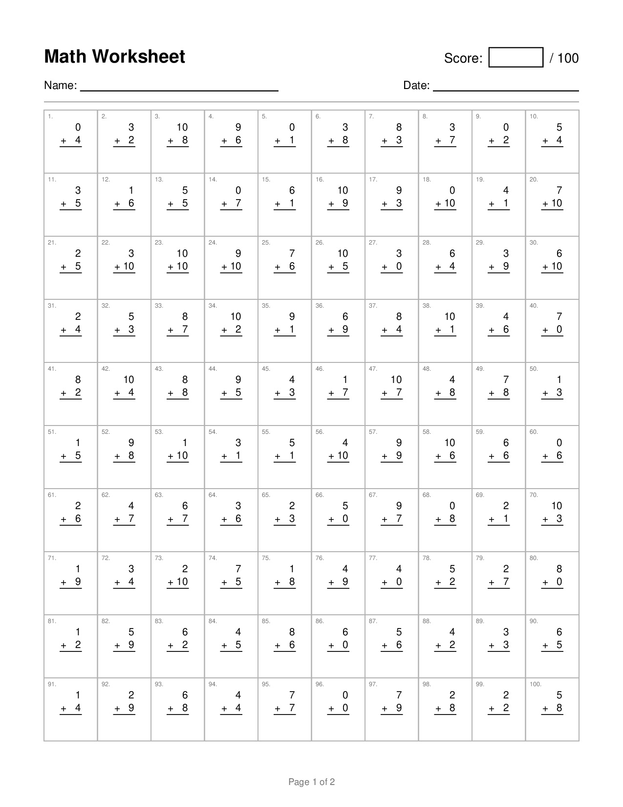

# math-worksheet

Generate random arithmetic worksheets (addition, subtraction, multiplication,
division) with an answer key.



*Page 1 of `uv run math-worksheet --rows 10 --cols 10 --seed 42 -o worksheet.pdf`
(page 2 is the answer key).*

## CLI

```sh
uv run math-worksheet --max 10                         # addition (default), up to 10 + 10
uv run math-worksheet --subtraction --max 100 -n 20    # never a negative answer
uv run math-worksheet --division --min 1 --max 12 -f json
uv run math-worksheet --add --sub --min -10 --max 10 --allow-negatives
uv run math-worksheet --add --sub --mul --div --seed 42 -o sheet.txt
```

| Option | Default | Meaning |
| --- | --- | --- |
| `--addition` / `--add` | on if no type given | include addition problems |
| `--subtraction` / `--sub` | off | include subtraction problems |
| `--multiplication` / `--mul` | off | include multiplication problems |
| `--division` / `--div` | off | include division problems |
| `--min` / `--max` | 0 / 10 | operand range (the difficulty) |
| `-n/--count` | 100 | number of problems (per worksheet) |
| `--allow-negatives` | off | allow negative operands and answers |
| `--seed` | random | make the worksheet reproducible |
| `-f/--format` | `text` | `text`, `json`, `csv`, or `pdf` (inferred from a `.pdf` output name) |
| `--no-answers` | off | omit the answers |
| `-o/--output` | stdout | write to a file |

Each type flag turns that type on; types you don't name are off. With no type
flags you get addition only. With several, each problem's type is picked at random.

Division always has a zero remainder: the divisor and the answer are drawn from
`[min, max]` and the dividend is their product (e.g. range 1-12 gives `72 / 9`).

## PDF worksheets

PDF output needs the optional ReportLab dependency (BSD-licensed; it and its dependencies ship prebuilt wheels for Windows, macOS and Linux):

```sh
pip install 'math-worksheet[pdf]'      # or: uv sync --extra pdf
```

```sh
uv run math-worksheet --max 100 -n 40 -o addition.pdf                 # 5x4 grid, stacked
uv run math-worksheet --div --min 1 --max 12 --rows 6 --cols 4 -o division.pdf
uv run math-worksheet --add --sub --mul --div --layout inline --rows 10 --cols 3 -o mixed.pdf
```

| Option | Default | Meaning |
| --- | --- | --- |
| `--rows` / `--cols` | 5 / 4 | problems per page = rows x cols; extra problems flow onto more pages |
| `--layout` | `vertical` | `vertical`: column arithmetic and the long-division bracket; `inline`: `7 + 5 = ____` |
| `--page-size` | `letter` | `letter` or `a4` |
| `--title` | `Math Worksheet` | page heading |
| `--no-grid` | off | omit the lines separating problems |
| `--worksheets` | 1 | number of worksheets in the PDF; see [Batches](#batches) |

Each problem sits in its own grid cell. Worksheet pages have a Name/Date line, and
the first page has a fillable `Score: [   ] / N` box (type into it in a PDF viewer,
or write in it on paper). Unless `--no-answers` is given, answer-key
pages with the same grid follow. Font size scales automatically to fit the grid.

From Python: `math_worksheet.pdf.write_pdf(problems, "out.pdf", rows=5, cols=4, layout="vertical")`.

### Batches

To print a week's worth of worksheets at once, use `--worksheets`. Each
worksheet gets its own problems, and they all go into **one PDF**, so the whole
batch prints as a single job:

```sh
uv run math-worksheet --worksheets 7 --rows 10 --cols 10 -o week.pdf
# Wrote 7 worksheets (700 problems, 14 pages) to week.pdf: worksheets on pages 1-7, answer keys on pages 8-14
```

All the worksheets come first, then all the answer keys in the same order, so
the printed stack splits into student copies and keys. To print only the student
copies, enter the page range the command reports (here `1-7`) in the print
dialog. Worksheets are titled `Math Worksheet #1`, `#2`, ... and each answer key
is titled to match (`Math Worksheet #1 — Answer Key`). Each worksheet has its
own Score box.

`-n/--count` is the number of problems on each worksheet. With `--seed`, the
batch is reproducible, and worksheet #1 has the same problems as a single
worksheet with that seed. `--worksheets` works with PDF output only.

Print **single-sided**. Double-sided printing would put worksheet #2 on the
back of worksheet #1.

## Library

```python
from math_worksheet import generate_problems

types = {"addition": True, "subtraction": True, "multiplication": False, "division": False}
generate_problems(types, count=3, max_value=20)
# {1: ('17 - 4', 13), 2: ('6 + 15', 21), 3: ('12 - 9', 3)}

generate_problems(count=3)                       # addition only (DEFAULT_TYPES)
generate_problems(["multiplication"], count=3)   # a list of types also works
```

`generate_problem_list(...)` returns `Problem` objects (`left`, `right`, `op`,
`answer`, `question`) if you need the structured data.

For a batch, `generate_worksheets(7, types, count=100, seed=42)` returns one
problem list per worksheet, and
`math_worksheet.pdf.write_worksheets_pdf(worksheets, "week.pdf", rows=10, cols=10)`
writes them all to one PDF.

## Development

```sh
uv run pytest
```
